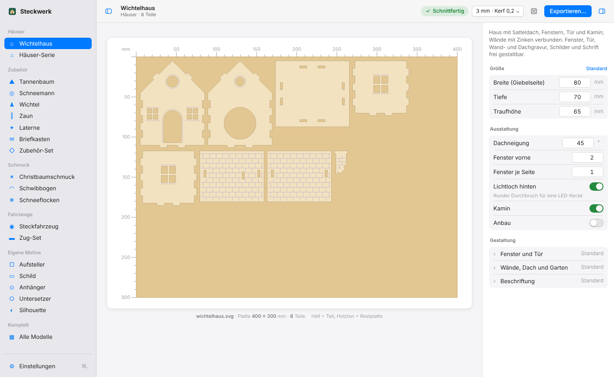
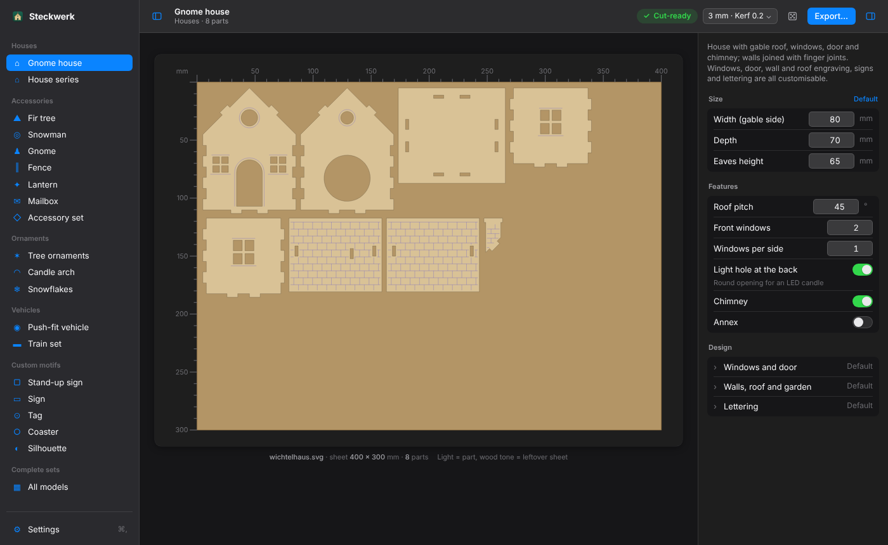
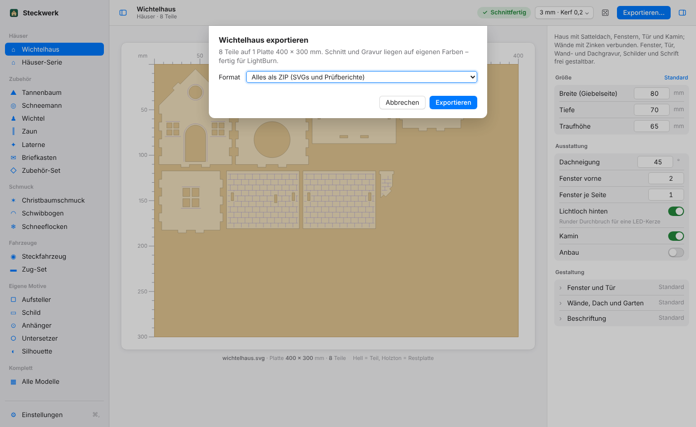
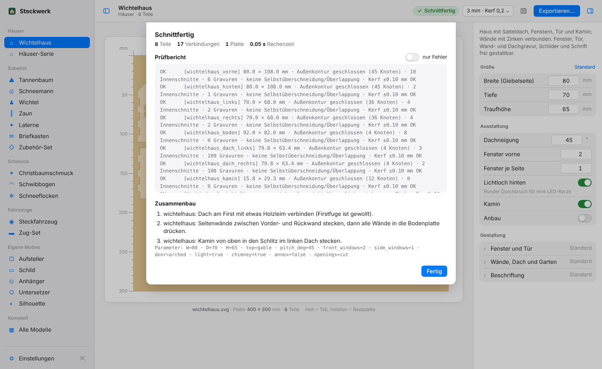

# Bedienung

## Oberfläche (seit 2.1.0 im Mac-Stil)







Die Weboberfläche sieht aus wie eine Mac-App, hell oder dunkel wie dein System, und lädt nichts aus dem
Internet.

- **Seitenleiste links:** oben ein Suchfeld (⌘K oder ⌘F), darunter **Zuletzt** benutzte Modelle. Die
  Gruppen sind in **Vorlagen** und **Aus Paketen** getrennt, zeigen ihre Anzahl und bleiben eingeklappt,
  bis du sie öffnest. Unten: **Motiv zeichnen …**, Updates, Einstellungen, in der App auch Ordner öffnen
  und Beenden.
- **Werkzeugleiste oben:** Modellname mit Gruppe und Teilezahl, der **Status** (grün *Schnittfertig*,
  rot bei Fehlern; Klick öffnet Prüfbericht und Zusammenbau), das **Material-Menü**, der **Würfel**
  (Gestaltung würfeln) und **Exportieren…**.
- **Mitte:** maßstäbliche Vorschau je Platte mit mm-Lineal. Holz = Material, schwarz = Schnitt,
  blau = Gravur. Bei mehreren Platten wählst du oben im Umschalter.
- **Inspektor rechts:** die Werte des gewählten Modells in *Größe*, *Ausstattung*, *Motive* und
  *Gestaltung*. *Standard* setzt zurück. Bei Texten fügen die Knöpfe ♥ ★ ❄ 🎄 Symbole ein, `|` macht
  eine neue Zeile. Seit 2.3.0 sitzt hier auch der [Assistent](KI-Funktionen.md).
- **Einstellungen (⌘,):** Material, Pakete, Motive, Updates, Assistent und Allgemein (Sprache,
  hell/dunkel, Live-Vorschau).

## Exportieren (⌘E)




- **ZIP** mit allen SVGs und Prüfberichten,
- nur die gezeigte **Platte als SVG**,
- oder direkt **in den Steckwerk-Ordner** speichern.

Ist ein Materialprofil aktiv, zeigt das Export-Fenster auch die Startwerte für xTool Creative Space.

## Tastenkürzel




| Kürzel | Wirkung |
|---|---|
| ⌘, | Einstellungen |
| ⌘E | Exportieren |
| ⌘↩ | Vorschau berechnen (wenn Live-Vorschau aus ist) |
| ⌘K / ⌘F | Modell suchen |
| Esc | Fenster schließen |

## Sprache

Deutsch und Englisch (seit 2.0.0), umschaltbar unter Einstellungen → Allgemein. Formular, Prüfbericht,
Montagehinweise, Fehlermeldungen und Update-Hinweise wechseln mit. Die Mac-Dialoge folgen der
Systemsprache, die Kommandozeile bleibt deutsch.

## Weboberfläche starten

```bash
python3 webui.py                 # http://127.0.0.1:8765
python3 webui.py --port 9000     # anderer Port
python3 webui.py --lan           # im Heimnetz, z. B. vom Tablet am Laser (ohne Passwort!)
python3 webui.py --out ~/laser   # Ordner für „In Ordner speichern“
```

## Konfigurator im Terminal

`python3 cli.py --konfigurator` fragt Modell, Maße, Optionen, Material und Ausgabeordner ab und zeigt am
Ende den passenden Kommandozeilen-Befehl.

## Kommandozeile

```bash
python3 cli.py --model wichtelhaus --out out
python3 cli.py --model serie --count 5 --seed 42        # Serie, reproduzierbar über den Seed
python3 cli.py --model ornament --options               # alle Gestaltungsoptionen eines Modells
python3 cli.py --model schwibbogen -O szene=kirche -O kerzen=9 -O "text=Glück auf!"
python3 cli.py --model zug -O wagen=3 -O "text=Polar,,Post,Nordpol"
python3 cli.py --model wichtelhaus --validate          # nur prüfen, nichts schreiben
python3 cli.py --check-svg datei.svg                    # fertige SVG prüfen
```

Jede Gestaltungsoption setzt du mit `-O NAME=WERT`. Die vollständige Liste steht im README unter
„Alle Optionen“.
