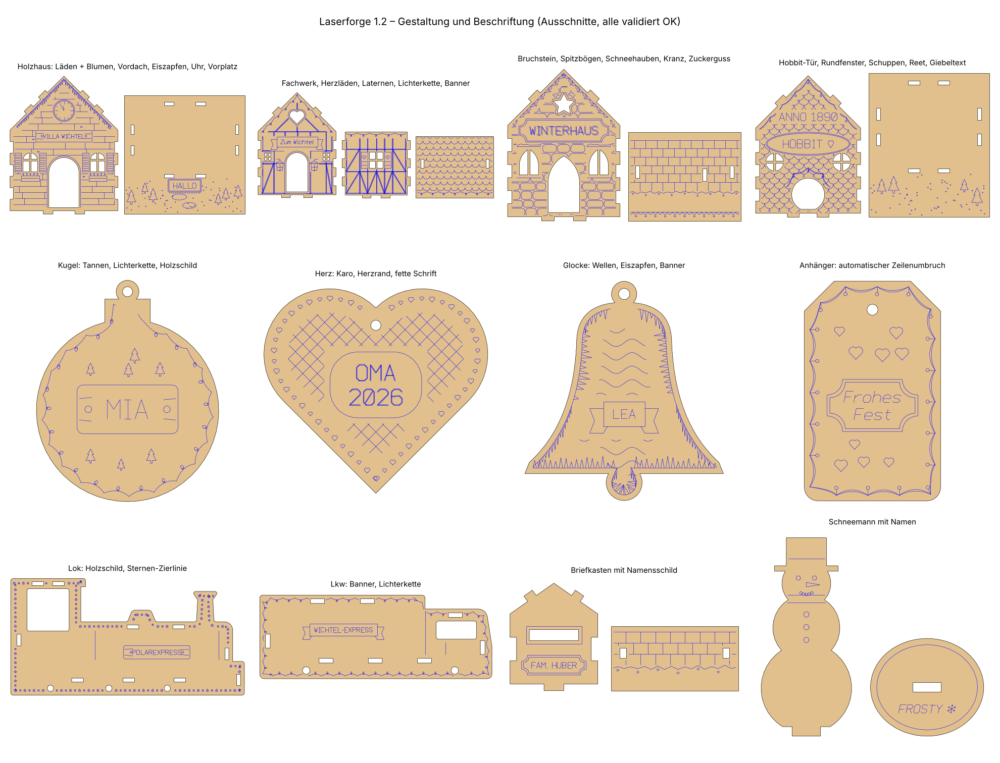

# Gestaltung und Beschriftung

Seit 1.2.0 gibt es viele Gravuren und Beschriftungen. Alles ist auswählbar und wird wie gewohnt geprüft;
Gravuren landen nie auf Schnitten.

## Was es gibt

- **Fenster und Tür:** Fensterformen, Sprossen, Läden, Blumenkästen, Schneehauben, Türschmuck.
- **Wände, Dach und Garten:** Fachwerk, Ziegel, Schindeln und mehr als Wand- und Dachgravur, Giebelschmuck,
  Vorplatz.
- **Zierleisten:** Eiszapfen, Lichterkette, Zuckerguss und weitere Linienstile.
- **Schilder** mit Rahmen und automatischem Zeilenumbruch.
- **Schrift:** sechs Schriftstile, Groß- und Kleinbuchstaben, Umlaute und die Symbole ♥ ★ ❄ 🎄.
  `|` macht eine neue Zeile, ein Komma trennt Namen (z. B. je Name ein Anhänger).

Texte gibt es auf Häusern, Briefkasten, Figurensockeln, Fahrzeugen, Schmuck und dem Schwibbogen.

## Bedienen

- In der Oberfläche im Inspektor unter *Gestaltung* (aufklappbare Gruppen; die Zeile zeigt, wie viele
  Optionen du geändert hast). Der **Würfel** würfelt eine Gestaltung.
- In der Kommandozeile mit `-O NAME=WERT`, Liste mit `--options`.
- Bei einer Serie steht die Gestaltung standardmäßig auf „zufall“ – jedes Haus sieht anders aus.

## Grenzen

- Die Schrift ist einlinig (Gravur). Unbekannte Zeichen wie € werden vorher gemeldet.
- Mindestens 2,5 mm Schrifthöhe; zu lange Texte auf kleinen Teilen werden abgelehnt statt unleserlich.
