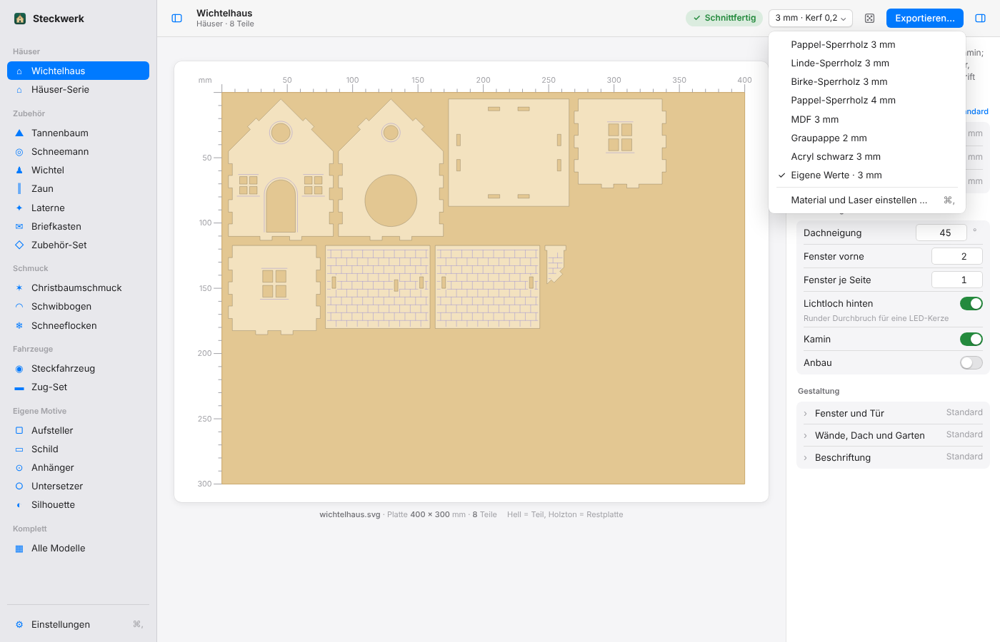
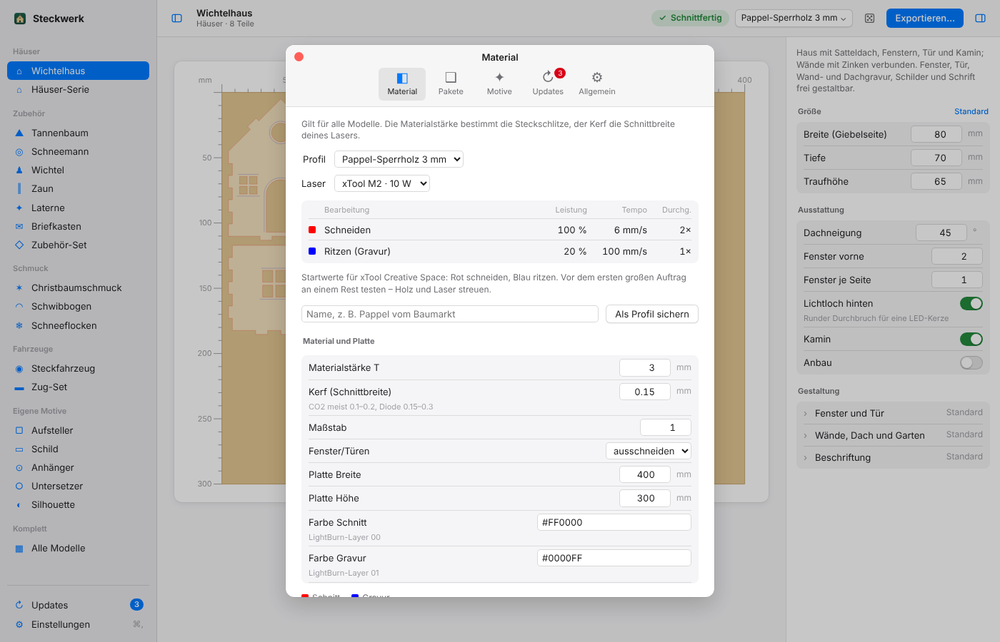

# Material und Laser

Dein Laser ist ein **xTool M2**, geschnitten wird mit **xTool Creative Space (XCS)**. Steckwerk ist darauf
abgestimmt; die SVGs funktionieren aber auch in LightBurn oder bei Glowforge.

## Farben im SVG

| Farbe | Bedeutung in XCS |
|---|---|
| **Rot** `#FF0000` | Schneiden |
| **Blau** `#0000FF` | Ritzen / Gravieren |

Ohne Materialprofil nutzt Steckwerk die eingestellten Layerfarben (Standard schwarz/blau).

## Materialprofile (seit 2.2.0)

Ein Profil setzt Materialstärke und Kerf, färbt die SVG für XCS und zeigt Startwerte für
Leistung / Tempo (mm/s) / Durchgänge. Du wählst es oben im Material-Menü.

| Profil | Stärke | Kerf | 10 W Schneiden | 20 W Schneiden |
|---|---|---|---|---|
| Pappel-Sperrholz 1,5 mm (Filigran) | 1,5 | 0,12 | 100 % · 16 · 1× | 100 % · 25 · 1× |
| Pappel-Sperrholz 2 mm (Filigran) | 2 | 0,12 | 100 % · 11 · 1× | 100 % · 18 · 1× |
| Pappel-Sperrholz 3 mm | 3 | 0,15 | 100 % · 6 · 2× | 100 % · 8 · 1× |
| Linde-Sperrholz 3 mm | 3 | 0,15 | 100 % · 7 · 2× | 100 % · 10 · 1× |
| Birke-Sperrholz 3 mm | 3 | 0,15 | 100 % · 4 · 3× | 100 % · 6 · 2× |
| Pappel-Sperrholz 4 mm | 4 | 0,18 | 100 % · 4 · 3× | 100 % · 6 · 2× |
| MDF 3 mm | 3 | 0,18 | 100 % · 3 · 3× | 100 % · 5 · 2× |
| Graupappe 2 mm | 2 | 0,15 | 100 % · 10 · 1× | 100 % · 15 · 1× |
| Acryl schwarz 3 mm | 3 | 0,12 | 100 % · 3 · 3× | 100 % · 4 · 2× |

Die Werte sind bewusst vorsichtig: lieber ein Durchgang mehr als angekokelte Kanten. Vor großen Aufträgen
an einem Reststück testen. Eigene Profile sicherst du unter Einstellungen → Material unter einem Namen
und trägst die Laserwerte selbst ein.

## Kerf richtig einstellen

Der Laser trägt links und rechts der Linie je **kerf/2** ab. Steckwerk gleicht das aus: Außenkonturen
werden um kerf/2 größer gezeichnet, Löcher und Schlitze um kerf/2 kleiner. Nach dem Schnitt stimmt das
Sollmaß.

**Kerf messen:** ein 20 × 20 mm-Quadrat schneiden und messen, `kerf = 20 − gemessen`.
Steckverbindungen zu locker → Kerf erhöhen, zu stramm → verringern (in 0,02-mm-Schritten).

## Plattengröße

Standard ist 400 × 300 mm. Große Modelle (Schwibbogen ab ca. 280 mm Breite, großes Spukschloss, Kürbis
320 mm) brauchen ein größeres Blatt: `--sheet` bzw. Einstellungen → Material.

## Der Validator

Läuft bei jedem Aufruf und prüft der Reihe nach:

1. jeden Schnittpfad (geschlossen, keine Selbstüberschneidung, Mindestgröße),
2. jedes Bauteil (Löcher in der Kontur, Mindeststeg, Gravur nur auf Material) – nominal und
   kerf-kompensiert,
3. den Kerf-Versatz,
4. alle Steckverbindungen (Zinken, Tab/Slot, Kreuzschlitz, Achse/Rad, Achse/Lager),
5. das Blatt (nichts ragt hinaus oder überlappt),
6. die fertige SVG-Datei, unabhängig vom Generator zurückgelesen.

Bei einem Fehler gibt es eine Meldung in Klartext mit Grenzwert – und keine wacklige Datei.

## Montage-Tipps

- **Wichtelhaus:** Seitenwände zwischen die Giebel stecken, Kasten in die Sockelplatte drücken, Dach
  aufsetzen (am First ein Tropfen Leim), Kamin einstecken, LED-Teelicht von hinten.
- **Fahrzeuge:** Querteile in eine Seitenwand, zweite Seitenwand drauf, Vierkantachsen durch die runden
  Lager, Räder aufpressen (≈ 0,8 mm Luft). Rad zu locker → Leim, zu stramm → Kerf −0,02.
- **Schwibbogen:** Bogen in die Bodenplatte stecken, LED-Lichterkette dahinter.
- **Schmuck 3D:** Teil B von oben auf Teil A schieben, bis die Kanten bündig sind.
- Innere Inseln (z. B. Pupillen) fallen beim Ausschneiden heraus – der Prüfbericht nennt sie; dann lieber
  gravieren.
